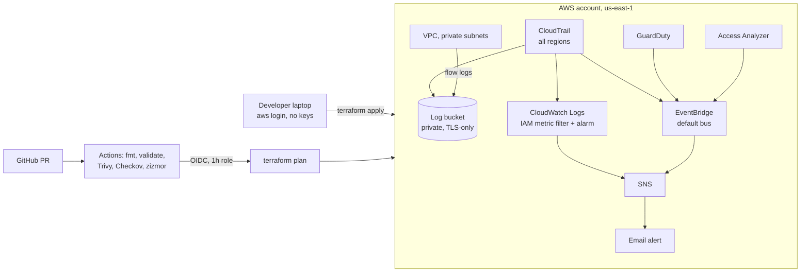

# AI-Twin

Can AI-written Terraform be trusted for security? I built a small, hardened AWS baseline by hand, then I'm having an AI build a "twin" from the same written specs. I'll scan both, deploy both and attack both with Stratus Red Team to see which one actually detects and resists the attacks.

**Status: v0.1, human baseline written, scanned and gated in CI. Not yet deployed:** AWS account verification is still pending, so deploying and running the attacks come next.

| Part | State |
|---|---|
| Human modules (secure-bucket, network, iam, foundation, detection) + envs/dev |written, `terraform validate` clean |
| Static analysis: Trivy + Checkov |  passing; exceptions documented |
| CI: fmt, validate, scanners, fixture gates, zizmor |  green on every PR |
| Plan via GitHub OIDC (no stored keys) | built, skipped until the AWS role exists |
| Deploy, AI twin, Stratus attacks |  next |

## Architecture



IAM is a global service and only sends its events to EventBridge in us-east-1, and this account runs in Sydney. So IAM changes are caught through CloudTrail → a CloudWatch Logs metric filter → an alarm instead. It works and stays in the free tier, but it's slower than EventBridge.

## What's in v0.1
- **secure-bucket**: no bucket in the project can be made public, lose its history or be read over plain HTTP. Every bucket is private, versioned, encrypted and rejects non-TLS requests.
- **network**: workloads have no direct path to the internet, and every connection attempt is recorded in flow logs for investigation.
- **iam**: no role can grant itself more than it was given. Permission boundaries cap every role, trust policies say exactly who can assume what, and nothing uses long-lived keys.
- **foundation**: there's always an independent, tamper-resistant record of what happened in the account (CloudTrail in all regions, GuardDuty, Access Analyzer, an account password policy).
- **detection**: an attacker can't quietly switch off logging or alerting. Deleting logs, trails or analyzers raises an alert, and so do silent changes such as editing a rule, target, alarm or topic.
- **CI**: no change reaches `main` without passing formatting, validation and two scanners, and without proving those scanners still catch known-bad code. Actions are SHA-pinned, providers are locked, and AWS access uses short-lived OIDC with write access to the lock file only.

## How the pipeline proves itself
A scanner that scans nothing looks exactly like a clean result, so CI also runs the scanners against fixtures that are broken on purpose. `scripts/assert-fixtures.sh` checks for the specific rule IDs each fixture should trigger, not just a non-zero exit code, because an exit code can't tell "caught it" from "crashed". One finding showed why this matters: on an `Action "*"` / `Resource "*"` IAM policy, Trivy reports nothing at any severity, while Checkov reports 9 checks. That gap is why the pipeline runs two scanners, and the gate also asserts that Trivy still misses it, so I find out if a Trivy update changes that.

## Bugs no scanner caught
- **EventBridge patterns that would never fire.** I wrote `aws-cloudtrail` instead of `aws.cloudtrail`, `DeletebucketPolicy` instead of `DeleteBucketPolicy`, and `aws.cloudwatch` where CloudWatch's real source is `aws.monitoring`. Event patterns are just JSON strings, so `validate` and both scanners accept them. I found these by writing the specs and checking the code against them line by line.
- **Flow logs that would never arrive.** I copied the flow-log bucket policy from the CloudTrail one, and it kept CloudTrail's `aws:SourceArn` condition. That blocks the flow-log service from writing, but the policy is valid and scans clean. I caught it in review, and after deploying I'll confirm objects land under `vpc-flow-logs/`.
- **A scanner silently skipping the fixtures.** Checkov's `skip-path` is a regex on the full path, and it loads the root `.checkov.yaml` even when `--config-file` is set. The fixtures were skipped and the run still looked clean. I spotted it when the "must fail" fixtures stopped failing. That's the reason the gate now checks rule IDs instead of exit codes.

## Security decisions and exceptions
See [docs/exceptions.md](docs/exceptions.md).
Zero findings can just mean the scanner wasn't looking. A documented exception gives the reason, the risk accepted and the condition for revisiting it.

## Run it yourself (no AWS needed)
```bash
terraform -chdir=envs/dev init -backend=false && terraform -chdir=envs/dev validate
trivy config --skip-dirs tests/fixtures --skip-dirs ai-twin --severity HIGH,CRITICAL .
checkov -d modules -d envs -d bootstrap --config-file .checkov.yaml
./scripts/assert-fixtures.sh
```

## Roadmap
**Next**
- Deploy: `bootstrap/` (state + CI role), then `envs/dev`
- Generate the AI twin from `specs/` into `ai-twin/`, and grade it exactly as written
- Run 4 Stratus Red Team attacks against both
- Publish the results matrix (human vs AI: scanner findings, detections, time to alert)

**Later**
- Customer-managed KMS key (so the SNS topic can be encrypted)
- S3 Object Lock on the log bucket
- Narrow CI permissions to the calls CloudTrail actually records
- Filter deploy noise out of the alerts

## Responsible AI
I used Claude as a reviewer and tutor: it explained errors and reviewed my diffs, but I typed every human module myself. Only `ai-twin/` is AI-written, and that separation is what makes the comparison fair. More detail will go in RESPONSIBLE_AI.md once it exists.
